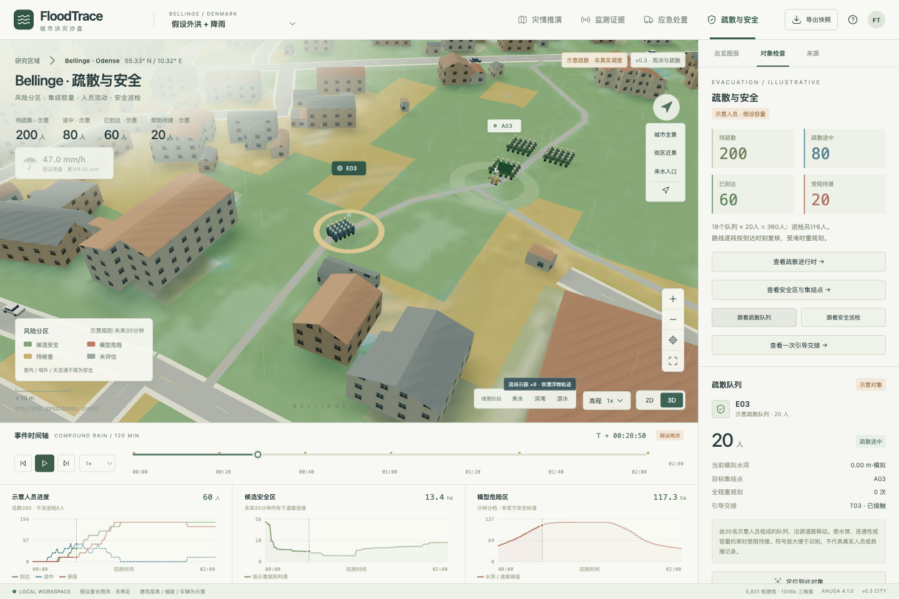
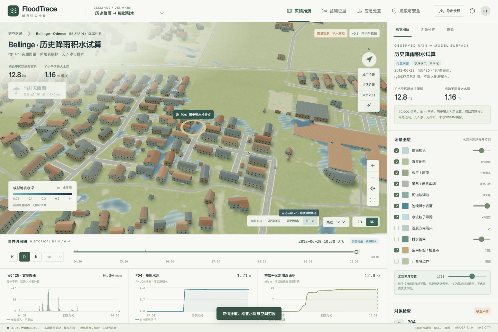

# FloodTrace

**城市雨洪、历史降雨积水与示意疏散 · Urban flood and evacuation sandbox**

个人研究项目，当前版本 **v0.3.0**。使用真实Bellinge空间资料、独立水动力求解和浏览器三维回放，观察雨洪、楼层淹没、风险分区、人员流动与巡检引导。



## 新版能力

- 两组真实计算的地表结果：假设外洪+降雨复合情景；2012年rg5425单站历史降雨驱动试算。历史页面已有积水水面。
- 历史雨量按rg5425 / rg5427分开，修正原版站点混用；两站不相加。
- 随雨强变化且密度限幅的雨滴，显示mm/h、累计量；降雨进入水动力源项。
- 绿色候选安全、红色模型危险、黄色待核查、灰色未评估分区，考虑后续30分钟和道路通达。
- 360名示意群众、18个队列、3个容量受限的预定集结点；沿源道路移动、检查水情、重规划或受阻待援。
- 3队6人巡检：往返检查与集结点引导；支持跟看队列、跟看巡检及引导交接定位。
- 保留真实地形、5,831个建筑轮廓、示意立面 / 屋顶、连续三维水面、RK2流场示踪、2D/3D、时间轴、历史监测 / 独立SWMM及快照导出。



## 本地体验

需要Node.js / npm和WebGL浏览器。仓库包含回放数据，不需要安装求解器即可体验：

```sh
git clone https://github.com/Dingyi-studios/floodtrace.git
cd floodtrace/app
npm ci
npm run dev
```

打开 `http://127.0.0.1:5179/`。构建与生产预览：

```sh
npm run build
npm run preview
```

生产预览 `http://127.0.0.1:5178/`。也可在根目录用`./start.sh`服务已构建文件，`./stop.sh`停止。

建议体验：

1. 进入「疏散与安全」，点击「查看疏散进行时」，再「跟看疏散队列」或「跟看安全巡检」。
2. 点击「查看一次引导交接」，观察队列、巡检和集结点；0.25×适合近景。
3. 切换「历史降雨 → 模拟积水」，进入「灾情推演」，点击「街区近景」和「窗口末」查看计算出的洼地积水；「最强降雨」查看限幅雨滴。
4. 「监测证据」分别显示两站雨量对照、实测水位和独立SWMM水头。

左键旋转、右键平移、滚轮缩放。空格播放 / 暂停，Home全景。物理时间暂停后，水情、累计量、人物、任务和容量停止；雨滴与流场粒子可继续视觉相位。

## 结果性质

真实资料包括地形、建筑轮廓、道路、水系、历史雨量和监测记录。地图水深、危险分区、建筑高度、人口、集结容量、人员和巡检都是模拟或示意，**不是历史灾害重建、官方安全判断或真实救援记录**。

| 情景 | 网格 / 单元 | 时长 / 帧 | 降雨 |
| --- | --- | --- | --- |
| 假设外洪 + 降雨 | 10 m / 102,400 | 120 min / 61 | 假设36.45833 mm |
| 历史降雨驱动 | 16 m / 40,000 | 6 h / 73 | rg5425实测19.40046 mm |

两组均无入渗、无排水，河道初始及边界有假设。ANUGA与SWMM使用独立进程，尚未交换水量。展示网格8 m，细于计算网格不代表提高了物理解析精度。详见 [模型与规则](docs/MODEL.md)。

## 目录与检查

```text
app/src/             三维场景、雨滴、连续水面、流场与人员模块
app/public/data/     冻结空间资料、地表场、风险分区与行动轨迹
scripts/v3/          雨量整理、独立计算、路线及验证
validation/v3/       新版数据 / 人员 / 浏览器检查记录
docs/                模型规则、依赖记录、截图与后续方向
```

```sh
node scripts/v3/test_operations.mjs
```

数值复现配置`FLOODTRACE_DATA_ROOT`（原始数据根目录）和`FLOODTRACE_PYTHON`（数值环境Python），再运行`./reproduce.sh`。原始大型输入、SWW/NPZ结果、依赖与交付压缩包继续保留本地，不纳入Git。浏览器回放数据在仓库中，单个场文件均小于50 MiB。

v0.2.0保存点继续保留。已实现与待实现事项见 [后续方向](docs/ROADMAP.md)。

## 来源与许可

[DTU / VCS Bellinge数据集](https://doi.org/10.11583/DTU.c.5029124) · [数据集论文](https://essd.copernicus.org/articles/13/4779/2021/)。EPSG:25832 / DVR90；源矢量2019年导出，不自动代表2012年资产状态。

多数源分包CC BY 4.0，雨量分包CC BY-NC 4.0，保留各分包条件。[数据与第三方许可提示](delivery/NOTICE-数据与许可.md)。原创代码独立许可证待作者确定。
