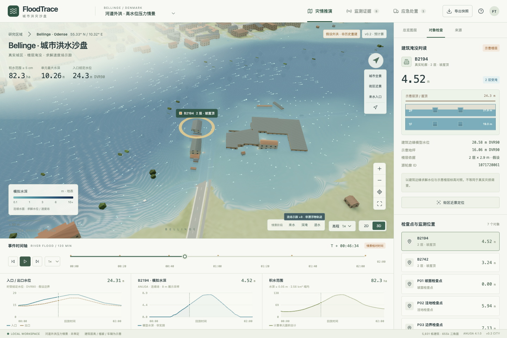

# FloodTrace

**城市洪灾三维沙盘 · Urban flood simulation and replay**

个人研究项目：用真实城区空间资料、独立水动力求解和浏览器三维回放，观察洪水进入街区、道路与建筑受淹、流向变化和假设应急行动。

当前保存版本：**v0.2.0**。这是可运行的研究原型，外洪场景为假设压力情景，未进行历史灾害重建或工程率定。



## 已实现

- Bellinge（丹麦）真实地形、5,831 个建筑轮廓、道路、河道、湖泊和管网空间背景。
- Three.js 交互式 3D / 2D 切换、镜头定位、图层控制、对象检查、曲线与时间轴联动。
- ANUGA 预计算：2.56 km²、102,400 个三角单元、120 分钟、61 帧，浏览器平滑回放。
- 由求解水位生成的连续三维水面、岸线、程序化天空反射及法线波纹。
- 沿模型速度场进行 RK2 平流的粒子与尾迹；干区、浅水和建筑遮罩；近景密度自适应。
- 建筑示意立面、窗格与屋顶，楼层淹没判读；街道标线与示意车辆。
- 灾情推演、监测证据、应急处置三个工作空间，以及 JSON 快照导出。
- 独立 SWMM 历史窗口与真实监测曲线；假设巡查路线、车辆、状态与行动日志。

## 本地运行

需要 Node.js / npm 和支持 WebGL 的桌面浏览器。仓库包含回放必需的冻结数据，无需安装 ANUGA 或 SWMM 即可体验界面。

```sh
git clone https://github.com/Dingyi-studios/floodtrace.git
cd floodtrace/app
npm ci
npm run dev
```

打开终端提示的 `http://127.0.0.1:5179/`。生产构建：

```sh
npm run build
npm run preview
```

生产预览使用 `http://127.0.0.1:5178/`。也可在项目根目录执行 `./start.sh`，由 Python 标准库服务已构建的 `app/dist/`；停止使用 `./stop.sh`。

建议先点击「街区近景」，比较「来水 / 深淹 / 退水」。左键旋转，右键平移，滚轮缩放；点击建筑查看示意楼层与水深。暂停固定水情及业务状态，粒子仍可展示冻结时刻的速度场。

## 如何理解这些结果

| 内容 | 数据性质 |
| --- | --- |
| 地形、建筑轮廓、道路、水体 | Bellinge 公开空间资料 |
| 当前外洪水面、深度、速度 | 假设河道水位驱动的 ANUGA 结果 |
| 楼层、屋顶高度、车辆、植被 | 示意几何，不是实测建筑高度 |
| 粒子与尾迹 | 速度场可视化，不是漂浮物或真实物体轨迹 |
| 2012 监测窗口 | 历史实测记录 + 独立、未率定 SWMM 水头 |
| 应急路线与资源 | 假设情景，不代表真实救援或通行安全结论 |

ANUGA 与 SWMM 在独立可执行进程中运行，尚未实现地表—管网水量耦合。当前外洪没有降雨、入渗或排水源项。历史窗口目前没有地表积水结果；空白水面不能解释为当时没有积水。现有历史雨量曲线还存在两个雨量站混用的问题，已列入待修正事项。

模型参数与二进制场格式见 [模型说明](docs/MODEL.md)。规划中的降雨、安全分区、人员疏散和巡检见 [后续计划](docs/ROADMAP.md)，均不属于此基线版本的已完成能力。

## 代码与数据

```text
app/src/              Three.js 场景、水面、粒子、交互、图表与界面
app/public/data/      浏览器回放必需的冻结空间资料与结果
scripts/              原版准备、独立求解、服务与打包脚本
scripts/v2/           v0.2 城市准备、ANUGA、派生与验证
validation/v2/        紧凑的数据、平流和浏览器验证记录
docs/                 模型说明、截图与后续计划
delivery/third-party/ 第三方许可原文
```

原始大型地形、原生 SWW / NPZ 求解输出、依赖、构建和交付压缩包不纳入 Git，仍保存在作者的本地项目中。`app/public/data/` 中最大文件约 39.4 MB，是回放用的水位 / 水深 / 速度场。

`node scripts/v2/test_tracers.mjs` 可直接检验坐标转换、RK2 平流和遮罩规则。完整数值复现还需要原始 Bellinge 数据与 GIS / ANUGA / SWMM 环境；当前求解脚本保留作者本机数据路径，迁移时需配置这些路径。前端运行不依赖这些求解路径。

## 来源与许可

数据：[DTU / VCS Bellinge 数据集](https://doi.org/10.11583/DTU.c.5029124)；[数据集论文](https://essd.copernicus.org/articles/13/4779/2021/)。平面坐标 EPSG:25832，高程基准 DVR90。

源模型等多数分包为 CC BY 4.0；雨量分包为 CC BY-NC 4.0。保留各分包条件，不能把整套数据重新声明为商业可用。详见 [数据与第三方许可提示](delivery/NOTICE-数据与许可.md)。原创代码的独立许可证待项目作者确定。
