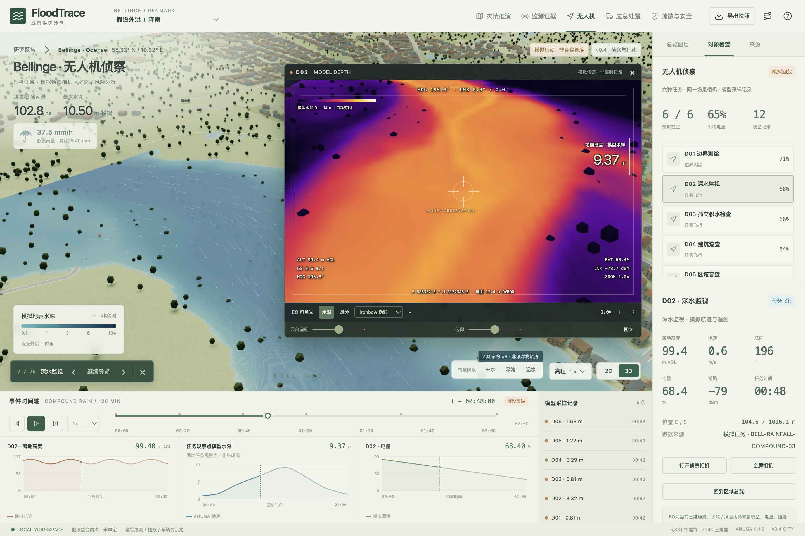
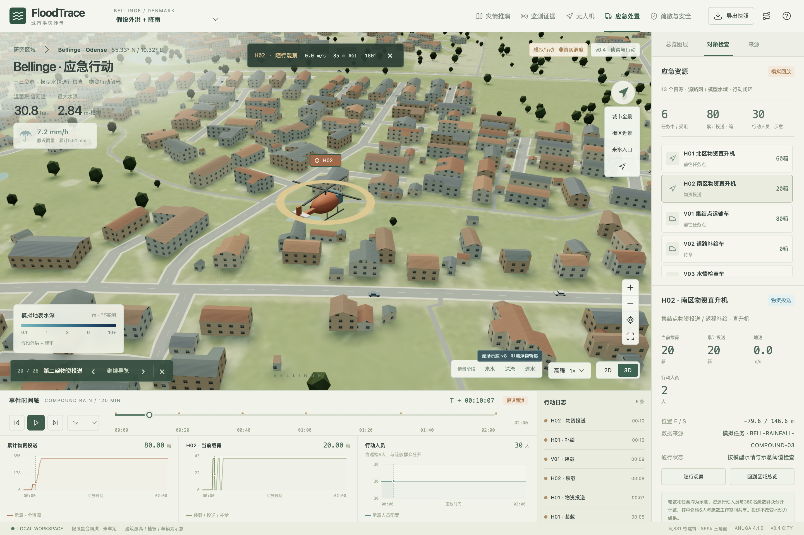

# FloodTrace

**城市雨洪、无人机侦察与应急行动 · Urban flood analysis & response sandbox**

个人研究项目，当前版本 **v0.4.0**。使用真实 Bellinge 空间资料、独立水动力求解和三维回放，把灾情、监测、侦察、资源与人员疏散放在同一片场景中检查。



## v0.4 新增

- 六架模拟无人机，承担边界测绘、深水监视、局部积水检查、建筑巡查、区域普查和通信中继；航迹、任务、遥测与选中对象联动。
- 同一三维场景的侦察相机：画中画 / 全屏、云台、1–6×变焦、EO 可见光、模型水深 / 风险、Ironbow / White hot 分析色板及地面准星采样。
- 十三个应急资源：2架直升机、2艘舟艇、3辆车辆、共享的3支巡检队、2支救援队和1个补给站；移动单位支持随行。
- 装载 → 运输 → 投送 → 返程 → 补给闭环；载荷、库存、累计投送、落点、图表与日志使用同一组时间事件。模型道路不满足条件时停驶。
- 顶部路线图标提供 **26段完整演示导览**，可逐段检查或自动浏览；[参考片段对照](docs/VIDEO-PARITY.md)。
- 五个工作空间的三联图和事件栏；按情景加载大型水场，复用一个 WebGL 渲染器绘制主视图与相机。



## 保留的雨洪与疏散能力

- 假设外洪 + 降雨复合情景，以及2012年 rg5425 单站历史降雨驱动试算。两组均已有实际求解的积水水面。
- rg5425 / rg5427 分站对照；进入地表计算的历史雨量采用 rg5425，两个站点不相加。雨滴密度随雨强变化并限幅。
- 绿色候选安全、红色模型危险、黄色待核查、灰色未评估，考虑未来30分钟模型水情和道路通达。
- 360名示意群众、18个队列、3个容量受限集结点；按预计到达时刻检查水情，重规划或受阻待援。
- 3队6人巡检往返检查、驻留和集结点引导；支持队列 / 巡检跟看及实际模拟近距离交接定位。
- 真实地形、5,831个建筑轮廓、示意立面 / 屋顶、连续水面、RK2流场示踪、2D/3D、历史观测 / 独立SWMM与快照导出。

## 本地体验

需要 Node.js / npm 和 WebGL 浏览器。回放数据已包含在仓库中，体验时无需安装求解器：

```sh
git clone https://github.com/Dingyi-studios/floodtrace.git
cd floodtrace/app
npm ci
npm run dev
```

打开 [本地开发预览](http://127.0.0.1:5179/)。构建与生产预览：

```sh
npm run build
npm run preview
```

生产预览为 [http://127.0.0.1:5178/](http://127.0.0.1:5178/)。也可在仓库根目录使用 `./start.sh` 服务已经构建的文件，`./stop.sh` 停止。Release 的静态 ZIP 可用 Python HTTP 服务直接打开，内附说明。

建议先点击顶部路线图标浏览完整演示，再自由检查：

1. 「无人机」选择 D02，打开相机，在可见光、水深、风险与色板之间切换；点击模型记录定位。
2. 「应急处置」选择 H01 / H02，点击行动日志进入投送或补给时刻，再随行观察。V03展示受阻停止。
3. 「疏散与安全」查看疏散进行时、跟看队列与巡检、定位一次引导交接。
4. 切换「历史降雨 → 模拟积水」，点击「街区近景」「窗口末」看洼地积水，「最强降雨」看108 mm/h的限幅雨滴；「监测证据」查看分站雨量与水位。

左键旋转、右键平移、滚轮缩放。空格播放 / 暂停，Home全景，Esc关闭相机或导览。**1×每秒推进60秒模型时间**，近景建议0.25×。物理时间暂停后，水情、人员、容量、遥测和物资固定；雨滴、水纹和示踪粒子可继续视觉相位。

## 数据性质

真实资料包括地形、建筑轮廓、道路、水系、历史雨量和监测记录。水深来自独立 ANUGA 试算。建筑高度、风险阈值、人口、集结点、无人机、遥测、资源与任务均有模拟或示意假设，**不是历史灾害重建、官方安全判断或真实救援记录**。EO相机是场景渲染，分析色板不表示实测热成像，模型记录不是计算机视觉识别结果。

| 情景 | 计算网格 / 单元 | 时长 / 帧 | 降雨 |
| --- | --- | --- | --- |
| 假设外洪 + 降雨 | 10 m / 102,400 | 120 min / 61 | 假设36.45833 mm |
| 历史降雨驱动 | 16 m / 40,000 | 6 h / 73 | rg5425实测19.40046 mm |

两组均无入渗、无排水，河道初始与边界有假设。ANUGA 和 SWMM 在独立进程中运行，尚未交换水量。8 m展示采样不代表提高了物理解析精度。物资投送不修改水动力。详见 [模型与规则](docs/MODEL.md)。

## 验证与复现

[版本验收记录](docs/VALIDATION-V04.md) · [参考片段对照](docs/VIDEO-PARITY.md) · [后续方向](docs/ROADMAP.md)。

```sh
node scripts/v3/test_operations.mjs
node scripts/v4/test_missions.mjs
```

数值复现配置 `FLOODTRACE_DATA_ROOT`（原始数据根目录）和 `FLOODTRACE_PYTHON`（数值环境Python），再运行 `./reproduce.sh`。v0.4的资源与导航验证分别为 `scripts/v4/prepare_missions.py` 和 `scripts/v4/validate_navigation.py`，依赖数值环境中的 NumPy、SciPy、Shapely、NetworkX。

```text
app/src/             工作空间状态、场景、相机、水面、流场与行动模块
app/public/data/     冻结空间资料、水场、安全分区与模拟任务
scripts/v3/          降雨、独立水动力、疏散与巡检
scripts/v4/          无人机 / 资源生成、导航与守恒验证
validation/v4/       精简验收记录；完整截图与运行日志保留在本地
```

大型原始输入、SWW/NPZ、开发依赖和完整交付包不纳入 Git；浏览器水场单文件均小于50 MiB。v0.2.0、v0.3.0保存点继续保留。

## 来源与许可

[DTU / VCS Bellinge数据集](https://doi.org/10.11583/DTU.c.5029124) · [数据集论文](https://essd.copernicus.org/articles/13/4779/2021/)。EPSG:25832 / DVR90；源矢量2019年导出，不自动代表2012年资产状态。

交互与展示方式参考 Dilum Sanjaya 的 [FireTrace 演示](https://x.com/DilumSanjaya/status/2108241054298415258)。本项目独立实现洪涝业务，保留真实 Bellinge 地貌；未声称获得原项目源码、真实设备数据或其算法。原视频材料不随仓库分发。

多数源分包 CC BY 4.0，雨量分包 CC BY-NC 4.0，保留各分包条件。[数据与第三方许可提示](delivery/NOTICE-数据与许可.md)。原创代码独立许可证待作者确定。
